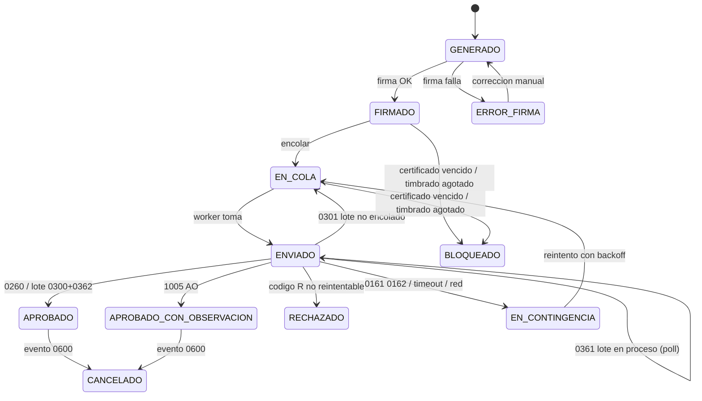

# Maquina de estados del Documento Electronico

> **Version:** 1.0
> **Fecha:** 2026-11-12
> **Estado:** Verificado (punto #11 de `puntos de verificacion.md`)
> **Base normativa:** Manual Tecnico SIFEN V150 (secciones 6.2, 12 y capitulo 14); RG 23/2019; catalogo de codigos en [`catalogo de codigos SIFEN.md`](catalogo%20de%20codigos%20SIFEN.md).

---

## 1. Aclaracion normativa

El SIFEN solo define el **resultado** de la validacion y tres estados de ciclo de vida:

- Resultado: **Aprobado (A)**, **Aprobado con Observacion (AO)** o **Rechazado (R)**.
- Ciclo de vida documentado: **aprobado**, **cancelado** e **inutilizado**.

Estados como `GENERADO`, `FIRMADO`, `EN_COLA` o `ENVIADO` son **de implementacion propia** y sirven para operar la cola, los reintentos y la auditoria. No se informan a la DNIT.

La **inutilizacion** aplica a rangos de numeracion no usados, no a un DE ya aprobado. Por eso se modela en la entidad "Rango de numeracion" y no como transicion de un DE.

---

## 2. Estados

### 2.1 DE

| Estado | Descripcion | Persistido |
|---|---|---|
| `GENERADO` | XML construido y validado contra XSD | Si |
| `ERROR_FIRMA` | La firma fallo (certificado, PIN o XMLDSig) | Si |
| `FIRMADO` | XMLDSig enveloped aplicada | Si |
| `EN_COLA` | Esperando que el worker lo tome | Si |
| `ENVIADO` | Transmitido; se espera respuesta o resultado de lote | Si |
| `EN_CONTINGENCIA` | Fallo temporal de la DNIT o de red; pendiente de reintento | Si |
| `APROBADO` | Resultado A del SIFEN | Si |
| `APROBADO_CON_OBSERVACION` | Resultado AO del SIFEN (por ejemplo, extemporaneidad) | Si |
| `RECHAZADO` | Resultado R del SIFEN | Si |
| `CANCELADO` | Evento de cancelacion registrado | Si |
| `BLOQUEADO` | Emision bloqueada por certificado vencido o timbrado agotado | Si |

### 2.2 Rango de numeracion

| Estado | Descripcion |
|---|---|
| `DISPONIBLE` | Rango habilitado con numeros libres |
| `AGOTADO` | Sin numeros disponibles |
| `INUTILIZADO` | Rango inutilizado ante el SIFEN por el evento correspondiente |
| `VENCIDO` | Fuera de la vigencia del timbrado |

---

## 3. Diagrama

---

## 4. Transiciones y disparadores

| # | Desde | Hacia | Disparador | Codigo SIFEN | Regla |
|---|---|---|---|---|---|
| 1 | `GENERADO` | `FIRMADO` | Firma XMLDSig correcta | | Un DE no se transmite sin firma |
| 2 | `GENERADO` | `ERROR_FIRMA` | Fallo de certificado, PIN o firma | 0001 0002 0120 0140 0141 | Requiere correccion manual |
| 3 | `ERROR_FIRMA` | `GENERADO` | Certificado o PIN corregido | | Reintento manual |
| 4 | `FIRMADO` | `EN_COLA` | Encolado exitoso | | |
| 5 | `EN_COLA` | `ENVIADO` | Worker inicia la transmision | | |
| 6 | `ENVIADO` | `APROBADO` | Aprobacion sincrona o de lote | 0260 0300 0362 | Final exitoso |
| 7 | `ENVIADO` | `APROBADO_CON_OBSERVACION` | Aprobado con observacion | 1005 | Final exitoso; registrar observacion |
| 8 | `ENVIADO` | `RECHAZADO` | Rechazo no reintentable | 0160 1101 1103 1104 1150 1151 | Requiere correccion o nuevo DE |
| 9 | `ENVIADO` | `EN_CONTINGENCIA` | Falla temporal | 0161 0162 | Reintentar |
| 10 | `ENVIADO` | `EN_COLA` | Lote no encolado | 0301 | Reintentar |
| 11 | `ENVIADO` | `ENVIADO` | Lote en procesamiento | 0361 | Consultar de nuevo con espera |
| 12 | `EN_CONTINGENCIA` | `EN_COLA` | Backoff cumplido | | Reintento automatico |
| 13 | `APROBADO` | `CANCELADO` | Evento de cancelacion aceptado | 0600 (evento) | Dentro del plazo |
| 14 | `APROBADO_CON_OBSERVACION` | `CANCELADO` | Evento de cancelacion aceptado | 0600 (evento) | Dentro del plazo |
| 15 | `FIRMADO` / `EN_COLA` | `BLOQUEADO` | Certificado vencido o timbrado agotado | 0002 1103 1104 | Bloqueo preventivo |

---

## 5. Politica de reintentos

| Parametro | Valor |
|---|---|
| Reintentos por falla temporal (0161, 0162, timeout, red) | Ilimitados con backoff hasta aprobacion o intervencion |
| Backoff | 1 min, 2 min, 5 min, 15 min, 30 min, 1 h, luego cada 6 h |
| Alerta interna | A las 24 horas sin aprobacion |
| Alerta critica | A las 72 horas desde la firma (limite de transmision normal) |
| Bloqueo de emision | Si el certificado esta vencido o el timbrado agotado |
| Revision manual | Todo DE en `RECHAZADO`, `ERROR_FIRMA` o `BLOQUEADO` |

> El Manual V150 marca la operacion de contingencia como "Futuro" (capitulo 14). En la practica se implementa con cola de pendientes y reintento.

---

## 6. Plazos normativos

| Operacion | Plazo | Fuente |
|---|---|---|
| Transmision normal desde la firma | Hasta 72 horas | MT V150 seccion 6.2 |
| Diferencia emision/transmision mayor a 120 horas | Tramite administrativo de normalizacion | MT V150; RG 05/2018 |
| Cancelacion de factura electronica | Hasta 48 horas desde la aprobacion | MT V150; FAQ e-Kuatia |
| Cancelacion de otros DTE | Hasta 168 horas (7 dias) | MT V150; FAQ e-Kuatia |
| Inutilizacion de numeracion | Dentro de los 15 dias del mes siguiente | MT V150; FAQ e-Kuatia |
| Rechazo por emision con mas de 720 horas | Codigo 1150 | MT V150 |
| Rechazo por envio adelantado mayor a 120 horas | Codigo 1151 | MT V150 |

---

## 7. Reglas de negocio asociadas

1. Un DE en `APROBADO` o `APROBADO_CON_OBSERVACION` no se vuelve a transmitir.
2. Un DE en `RECHAZADO` no se reenvia con el mismo CDC; se corrige y se emite uno nuevo.
3. `APROBADO_CON_OBSERVACION` cuenta como valido para el cliente, pero genera alerta operativa.
4. La cancelacion solo aplica a DE aprobados y dentro del plazo; fuera de plazo requiere tramite administrativo.
5. La inutilizacion se registra por rango y no cambia el estado de DE ya aprobados.
6. Todo cambio de estado se audita con fecha, usuario o proceso, codigo SIFEN y payload resumido.
7. El numero de documento se reserva al pasar a `GENERADO`; si el DE termina en `ERROR_FIRMA`, el numero no se reutiliza automaticamente.

---

## 8. Implementacion en base de datos

Campos minimos para soportar la maquina:

| Campo | Tipo | Uso |
|---|---|---|
| `estado` | texto o enum | Estado interno actual |
| `resultado_sifen` | texto | A, AO, R o vacio |
| `codigo_sifen` | texto | Ultimo codigo recibido |
| `intentos_envio` | entero | Contador de reintentos |
| `proximo_intento` | timestamp | Backoff |
| `fecha_firma` | timestamp | Base para el plazo de 72 horas |
| `fecha_aprobacion` | timestamp | Base para el plazo de cancelacion |
| `fecha_ultimo_evento` | timestamp | Auditoria |

Se recomienda una tabla `de_transiciones` (append-only) con `de_id`, `estado_anterior`, `estado_nuevo`, `codigo_sifen`, `fecha`, `actor` y `detalle`.
